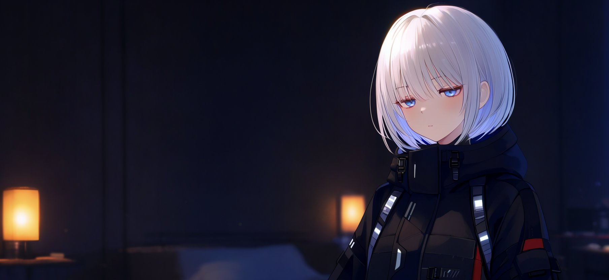

<div align="center">

# 🎨 Local_Image_with_Aina

**SDXL parameter baselines · MOSS-Image local deployment · LoRA training log**

One 12 GB consumer GPU, running a 5B DiT plus a 9B text encoder —
then training a usable style LoRA on images we generated ourselves.

<sub>**English** · [中文](README.zh-CN.md)</sub>


</div>

---

## 📌 What this is

Not a tutorial — a field log.

Most write-ups about MOSS-Image stop at "install the plugin, hit queue."
The moment you actually try it, you hit a pile of things nobody wrote down:
the plugin quietly requires a newer core, `--lowvram` is a no-op in the
default configuration, the quantization format recorded inside the file
doesn't match the filename…

This repo lays the whole path open: **what broke, how we verified it,
which setting finally won, and why.**

> **The first step of Project_Aina.**
> This local-first workflow will keep growing toward **animation, music, and games** —
> get the image layer fully mapped and reproducible first, then move on to the next modality.

---

## 🏆 Two core results

<table>
<tr>
<td width="50%" valign="top">

### ① 12 GB is enough for a 5B DiT

| Item | Measured |
|---|---|
| Resolution | `832 × 1808` |
| Sampling | 50 steps / CFG 3 / euler + sgm_uniform |
| Per image | **52–60 s** |
| VRAM peak | **11.1 GB** / 12.3 GB |

The trick is **time-sharing, not downgrading**:
the int8 DiT and the w4a8 text encoder never reside together —
the encoder is released the moment it finishes.

</td>
<td width="50%" valign="top">

### ② The LoRA sweet spot is 300 steps

10 checkpoints × 3 strengths × 2 scenes × 3 seeds = **180 images**,
laid out as 18 strips and picked blind, one group at a time:

```
300 steps  ██████████████  14/18  ← sweet spot
1000 steps ██               2/18
200 steps  █                 1/18
700 steps  █                 1/18
```

**300 steps + 0.8 in bright scenes / 1.0 in dark scenes** is the final recipe.

</td>
</tr>
</table>

---

## 🖼 Results

<div align="center">

| SDXL baseline (768×1664) | MOSS + 300-step LoRA · bright |
|---|---|
|  |  |

| Pure base watercolor (no LoRA) | MOSS + 300-step LoRA · dark |
|---|---|
|  |  |

</div>

The four images map onto four positions in the pipeline:
SDXL baseline → MOSS bright → pure-base watercolor branch → MOSS dark.

---

## 🧭 The pipeline

```
        ┌─────────────────────────────────────────────┐
        │       SDXL stack (style & data source)       │
        │  base model + style LoRA + character LoRA    │
        │  CFG 5.0 · euler_ancestral · 28 steps        │
        └──────────────────┬──────────────────────────┘
                           │  70 hand-picked outputs
                           │  (synthetic data)
                           ▼
        ┌─────────────────────────────────────────────┐
        │     Captioning: content only, no style       │
        │  [style trigger] + [subject/count/shot/scene]│
        └──────────────────┬──────────────────────────┘
                           │
                           ▼
        ┌─────────────────────────────────────────────┐
        │   KohakuMossTrainer · vram_12g profile       │
        │   1000 steps · 3.4 s/step · 58 min · 4.7 GB  │
        └──────────────────┬──────────────────────────┘
                           │  10 checkpoints
                           ▼
        ┌─────────────────────────────────────────────┐
        │  180-image matrix · fixed seeds · 18 strips  │
        │  → 300 steps wins (14/18)                    │
        └──────────────────┬──────────────────────────┘
                           │
                           ▼
        ┌─────────────────────────────────────────────┐
        │      MOSS stack (inference)                  │
        │  int8 DiT + w4a8 TE + flux2-vae-small        │
        │  50 steps · CFG 3 · shift 5 · 832×1808       │
        └─────────────────────────────────────────────┘
```

> **No concrete prompts or ComfyUI workflow JSON live in this repo.**
> What's here is structure and method: which parameter does what,
> what belongs in the LoRA, what belongs in the caption.

---

## 📂 Layout

```
.
├── README.md                      # you are here
├── README.zh-CN.md                # 中文版
├── docs/
│   ├── 01_sdxl-params.md          # SDXL parameter baseline (numbers and reasoning only)
│   ├── 02_moss-deployment.md      # MOSS deployment, failure by failure
│   └── 03_moss-lora-training.md   # LoRA training log (the main course)
├── scripts/
│   ├── bench-llamacpp.mjs         # streaming benchmark for OpenAI-compatible endpoints
│   ├── moss-matrix-batch.py       # batch parameter matrix + contact sheets
│   └── yolo-hand-check.py         # hand-detection screening before training
└── assets/                        # previews
```

---

## 🚀 Quick start

### Running MOSS-Image

```bash
# 1. Grab a newer core (>= v0.42.4; v0.45.2 verified here)
git clone https://github.com/Comfy-Org/ComfyUI.git ComfyUI-MOSS
cd ComfyUI-MOSS && git checkout v0.45.2

# 2. Reuse the existing torch in a venv that doesn't pollute the original env
python -m venv --system-site-packages .venv
./.venv/Scripts/python.exe -m pip install -r requirements.txt

# 3. Fetch three files (~12 GB) into the matching folders
#    diffusion_models/moss_image_base_int8_convrot.safetensors
#    text_encoders/qwen3.5_9b_w4a8_gptq.safetensors
#    vae/flux2-vae_small.safetensors

# 4. Launch (no VRAM flags needed — they're all no-ops)
python main.py --port 8189 --use-sage-attention --cuda-malloc
```

Node chain: `UNETLoader → CLIPLoader(type=moss_image) → VAELoader → KSampler`.
Details in [`docs/02_moss-deployment.md`](docs/02_moss-deployment.md).

### Running the parameter matrix

```bash
python scripts/moss-matrix-batch.py \
  --ckpt-dir /path/to/runs/moss/mylora/checkpoints \
  --lora-dir /path/to/ComfyUI/models/loras \
  --image-dir /path/to/ComfyUI/output \
  --steps 100 200 300 400 500 600 700 800 900 1000 \
  --weights 0.6 0.8 1.0 \
  --seeds 4401 4402 4403
```

---

## 🕳 Pitfall cheat sheet

<details>
<summary><b>Expand: the 7 traps that cost the most time</b></summary>

<br>

| Trap | What's actually true |
|---|---|
| Community MOSS nodes | `manaigc/comfyui-moss-Image` **does not exist**; the rest are add-ons, none is a compatibility shim |
| The official plugin | It imports `comfy.storage` itself, so it **ImportErrors on an old core** — installing the plugin is upgrading the core |
| `--lowvram` | The source says it plainly: `Doesn't do anything if dynamic vram is enabled` — and NVIDIA enables it by default |
| `--normalvram` | **Doesn't exist at all**; you get `unrecognized arguments` |
| Quantization filenames | The name says `gptq`, the file records `asym_w4a8_int8` — only `.comfy_quant` tells the truth |
| `KEEP_LAST` | Defaults to 3, so a 1000-step run keeps only the last 3 checkpoints and deletes the rest |
| `warmup >= STEPS` | A 100-step smoke test is rejected outright; override SCHEDULE as a whole |

</details>

---

## 📚 Reading the three docs

| Doc | For whom | Core content |
|---|---|---|
| [SDXL parameter baseline](docs/01_sdxl-params.md) | Reproducing the baseline | Parameter tables, why these numbers, why CFG doesn't transfer across architectures |
| [MOSS deployment](docs/02_moss-deployment.md) | Running it on your own box | Version thresholds, quantization checks, VRAM time-sharing |
| [LoRA training](docs/03_moss-lora-training.md) | Training your own style | Synthetic data, captioning philosophy, blind matrix selection, three counter-intuitive findings |

---

## 💡 One last thing

> **Parameters are dead; eyes are alive.**

The most expensive lesson of this round wasn't a mis-set parameter.
It was being corrected twice by a human eye — twice when the metrics
said everything was fine and the picture said otherwise.
Use metrics to catch anomalies. Leave the judgement to your eyes.

<div align="center">

---

Made with too many late nights and 180 comparison images (´-ω-`)ﾉ

</div>
